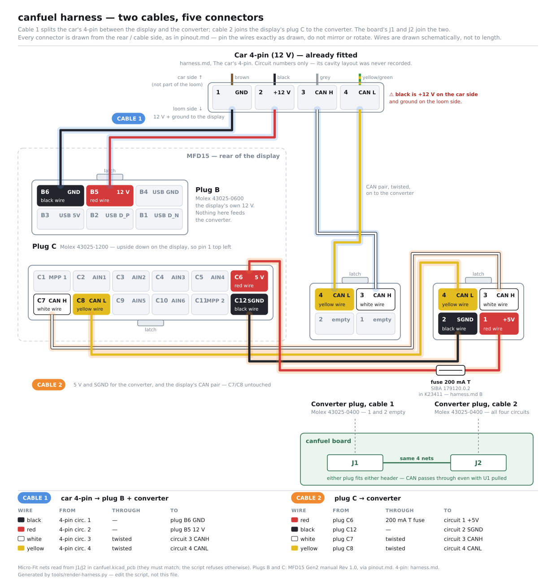
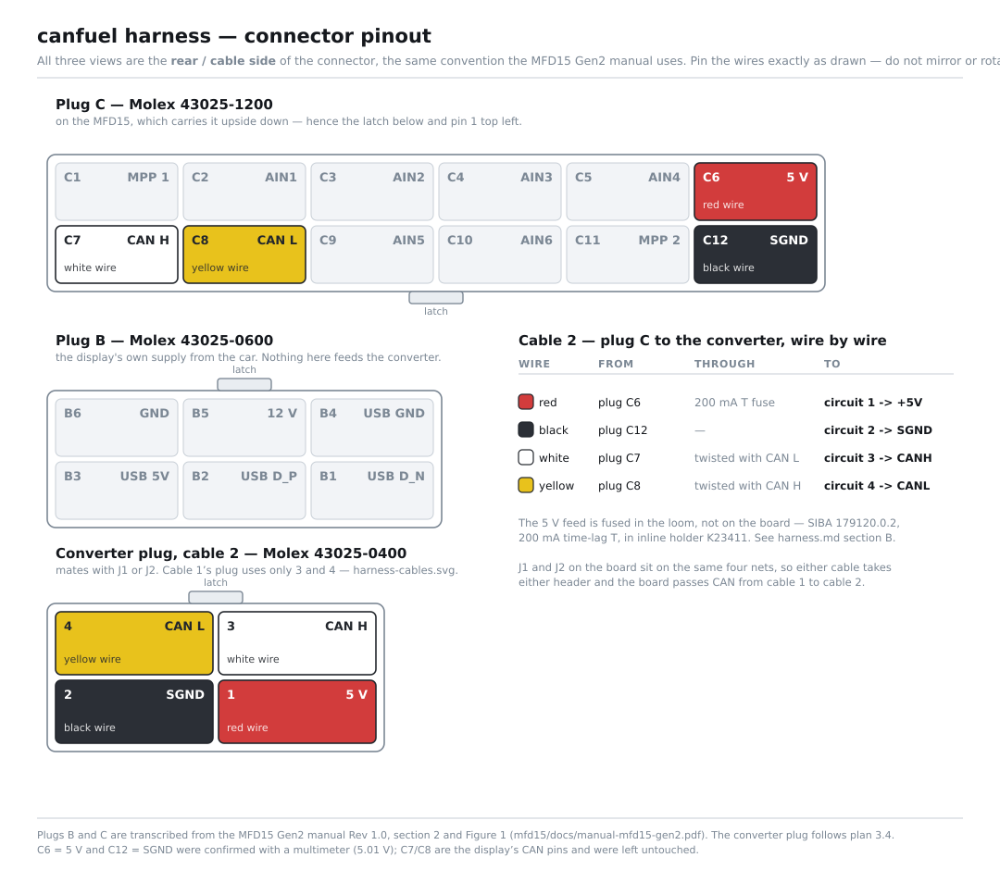

# Building the harness

The loom that connects the MFD15 to the car and to the converter board. It is
**two cables**, and the converter board is what joins them:

- **Cable 1 — three connectors.** The car's 12 V 4-pin at the top, splitting
  into **plug B** on the MFD15 (12 V and ground, red and black) and a
  **converter plug** (the CAN pair, white and yellow, twisted). Its converter
  plug fills circuits 3 and 4 only; 1 and 2 stay empty.
- **Cable 2 — two connectors.** **Plug C** on the MFD15 to the second
  **converter plug**: 5 V through the fuse (red), SGND (black) and the
  display's own CAN pair from C7/C8 (white and yellow, twisted).

J1 and J2 on the board sit on the same four nets (plan 3.4), so either cable
goes on either header, and the board carries CAN from cable 1 to cable 2 —
from the car to the display — even with the PIC out of its socket. It also
means **the display sees no CAN unless the board is plugged in.**



`harness-cables.svg` is generated by `tools/render-harness.py`; the Micro-Fit
nets in it are read from J1/J2 in `canfuel.kicad_pcb`. Which wire is on which
cable — cable 1's converter plug with circuits 1 and 2 empty included — was
described and then confirmed by the owner against the built loom
(23/11/2026).

> **Built, fitted and measured on a reference vehicle.** The dashboard came
> apart, the old loom came out, and a complete new one went in — longer 12 V
> and ground into the display's plug B, the CAN pairs and the 5 V/SGND run
> terminating in the two Micro-Fits that the converter board plugs into.
> **5.01 V measured at cable 2's converter plug itself**, which is the number that
> matters: it is the supply the board will see, through the fuse and both
> splices, not a reading taken at plug C before the loom existed. The display
> was then run on this loom with the two CAN pairs joined by DuPont jumpers in
> place of the board, and it worked.
>
> **What this document does not cover is the board**, only the loom. See
> `canfuel/docs/firmware/install.md` step 4.
>
> The checkboxes below are deliberately left unticked: this is the procedure
> for building one, and everything learnt while building ours has been folded
> back into the steps rather than recorded as ticks.

## The car's 4-pin — the top of cable 1

**Not a new choice.** It exists and is already fitted; cable 1 is a re-crimp
onto longer wires. The loom half of it is the lead supplied with the display —
the CANchecked cable (<https://www.canchecked.de/mfd15-gen2-52mm-can-bus-anzeige/>).

| Circuit | Signal       | Car-side wire | Tapped onto, in the car | Cable 1 wire | Goes to |
| ------- | ------------ | ------------- | ----------------------- | ------------ | ------- |
| 1       | ground       | brown         | —                       | black        | plug B6 |
| 2       | power (12 V) | black         | black/violet wire, pin 1 of the cluster's **blue** connector | red | plug B5 |
| 3       | CAN H        | grey          | orange/black wire, pin 19 of the cluster's **green** connector | white | converter plug 3 |
| 4       | CAN L        | yellow/green  | orange wire, pin 20 of the cluster's **green** connector | yellow | converter plug 4 |

**A record of the car, not of a part** — written down on the vehicle while the
wires were in hand, which is how the sourcing rule in the top-level `CLAUDE.md`
settles facts about the car. Nothing in the board design depends on it. It is
kept because none of it is legible from the wire once the dashboard is back
together. The cavity layout of the 4-pin was never recorded, so nothing here
or in `harness-cables.svg` draws one.

⚠ **Two things about this connector mislead.** Its circuit order is **not**
the converter plug's — here 1 is ground and 2 is power, on the converter plug
1 is +5V and 2 is SGND; do not carry one layout over to the other. And **black
is +12 V on the car side and ground on the loom side.**

**What you need:** crimping pliers, pin extractors, multimeter, spare ACI pins,
spare Micro-Fit 43030 sockets, butt splices with adhesive-lined heat shrink,
cable ties, fabric loom tape.

---

## A. On the bench — making up the loom

- [ ] **A1. Test crimp on an ACI pin first.** Take a spare pin and crimp it
  onto 0.5 mm² FLRY with the pliers (second jaw position, 22–18 AWG). Pull on
  the wire — it must hold. Slide on the yellow seal, insert it into the
  housing; it must click and the red lock must go on.
  - ❗ If it does not hold, you need a second pair of pliers for waterproof
    connectors. Find that out now, on the bench, not with the dashboard in
    pieces.
- [ ] **A2. Cut the new wires.** Cable 1: red and black for the power run to
  plug B, yellow and white for the long CAN run from the 4-pin to the air
  vent. Cable 2: red and black from plug C6/C12 to the air vent. Err
  on the long side — shortening is always possible and this is a re-crimp
  precisely because the first set came out short.
- [ ] **A3. Twist the CAN pair** along its whole length — on both cables.
- [ ] **A4. Crimp the ends.** ACI pins on the car side, Micro-Fit 43030 sockets
  on the housing side. Tug every one by hand.
- [ ] **A4a. Fit the sockets into the two Micro-Fit housings (43025-0400) in
  the right cavities.** The order is fixed by plan 3.4 and matches the pads of
  J1/J2 on the board. **Work it out before crimping, not mid-build.**

  | Micro-Fit circuit | Net  | Wire   | Cable 1 from | Cable 2 from |
  | ----------------- | ---- | ------ | ------------ | ------------ |
  | 1                 | +5V  | red    | — empty      | C6, via the fuse |
  | 2                 | SGND | black  | — empty      | C12          |
  | 3                 | CANH | white  | 4-pin 3      | C7           |
  | 4                 | CANL | yellow | 4-pin 4      | C8           |

  ❗ **Cable 1's red and black are 12 V and ground for plug B and must never
  reach a Micro-Fit** — 12 V on circuit 1 is the board's +5V rail.

  **Find the cavities from the moulded `1`, not by counting from an end** —
  seen from the wire side the numbering is the mirror of what it is from the
  mating face, so counting is exactly how this gets swapped. Circuits 1 and 2
  are the row the `1` belongs to; 3 and 4 are the other row, with **3 directly
  across from 1** and 4 diagonally opposite it. So the white wire goes across
  from the `1`, the yellow one diagonally from it.

  On the housings actually bought (moulded `MSH`), held wire-side towards you
  with the board header behind, the `1` is the **bottom right** cavity, so:

  ```
      4 CANL yellow    3 CANH white     upper row
      2 SGND  black    1 +5V   red      lower row, nearer the PCB
  ```

  That is the same way round as the board: J1/J2 pad 1 (+5V) is the right-hand
  pad of the row at the board edge and pad 3 (CANH) sits directly behind it,
  because the lower row of a right-angle header is the one nearest the PCB.

  The cavities, cable side, for plugs B, C and the converter plug:

  

  `pinout.md` is the page that goes with it. `harness-connector.svg` draws the
  plug beside the board pads, generated from the pad coordinates in
  `canfuel.kicad_pcb`; `harness-nets-on-pcb.svg` is the same four nets on the
  real copper, turned the way up the 1:1 paper print comes out.

  **On a bare board the two pairs can be told apart by eye**: +5V is routed at
  0.8 mm and CANH/CANL at 0.4 mm, so the fattest tracks leaving the connectors
  are the power pair. SGND has no track at all — it is entirely the pour.

  ❗ Swapping CANH and CANL only stops the bus working. Putting a CAN wire in
  circuit 1 or 2 puts **5 V on it** — plan 3.4 calls that a dead transceiver.
  So **ring circuit 1 out to the board's +5V pad before the first power-up**,
  which is also the only check that catches a housing whose numbering does not
  follow the header's.
- [ ] **A5. Fit two sockets (5 V, SGND) into the existing 12-pin housing of
  plug C** — cable 2 — positions C6 and C12. **Do not touch C7/C8** — those
  are the display's CAN pins and they are already right.
- [ ] **A6. Ring everything out.** Every wire end to end, and no short between
  adjacent positions. Do this before the fuse goes in, so that a later failure
  has only one new thing to blame.

## B. On the bench — the 5 V fuse

The converter takes 5 V straight from the display, so a short on the converter
board is a short across the MFD15's 5 V rail. The fuse ends that. It is in the
loom rather than on the board because no 5 × 20 holder fits on a finished
55 × 45 mm PCB — plan 9.2 has the measurements and the reasoning.

**Parts:** SIBA 179120.0.2, 200 mA 250 V 5 × 20 mm glass, **time-lag T** — not
the fast F version — in inline cable holder K23411, which comes with 200 mm of
lead. The holder body is about 46 mm long and 10.5 mm across, so it needs a
straight run of loom that length and somewhere it can be unscrewed.

- [ ] **B1. Cut cable 2's 5 V wire only**, a short way back from its converter
  plug at the air vent end. Leave the ground wire whole. Place the cut so the holder
  ends up in the length of loom that comes out when the MFD15 is pulled — the
  whole point is that the fuse can be changed without dismantling the dash.
- [ ] **B2. Join each cut end to one lead of the holder.** Crimp butt splices
  with adhesive-lined heat shrink are the right way. Soldering is acceptable if
  the joint is then sleeved well past the wick on both sides — a soldered joint
  in a loom that vibrates cracks exactly at the edge of where the solder
  travelled.
- [ ] **B3. Cable-tie the holder to the loom** so it cannot swing and chafe
  against the vent housing.
- [ ] **B4. Ring it out again** — continuity from plug C position C6 through to
  cable 2's converter plug, circuit 1, with the fuse fitted. Then pull the fuse and confirm the circuit
  really does open. That second half is the one worth doing: it proves the fuse
  carries the current and that no splice quietly bypasses it.

## C. In the car — routing

- [ ] **C1. Take the dashboard apart** (radio, centre panel).
- [ ] **C2. Route cable 1's long CAN run** from the 4-pin to the air vent, so
  that its converter plug can be pulled out of the vent.
- [ ] **C3. Route cable 1's power wires** from the 4-pin to plug B. **This is
  12 V for the MFD15 itself, not for the converter**, which takes its 5 V off
  plug C on cable 2.
- [ ] **C3a. Route cable 2** from plug C to the air vent, the fuse holder in
  the length that comes out with the MFD15.
- [ ] **C4. Do not tape anything up yet.** Loom it right at the end, once
  everything is in place and reaches.

## D. Finishing

- [ ] **D1. Tape up the looms and tidy the routing.** Use **fabric loom tape,
  not PVC insulating tape** — at dashboard temperatures PVC adhesive creeps,
  which is the same reason the board is not taped down either.
- [ ] **D2. Wrap up to the fuse holder and start again after it** — the
  holder body stays outside the tape. *This said "overridden on the build:
  the holder is wrapped over as well" until 18/11/2026.*

  **Why the override was undone (18/11/2026, in the car).** The converter
  dropped out now and then — the CAN link alone, or a restart, or not
  running at all — and pressing on the MFD15's body, which is pressing on
  the holder behind it, always brought it back. The holder had been taped
  over on a section of loom bent hard, and the tape pulling on the
  holder's cap can slacken the spring that makes the contact. Across cable
  2's converter plug, 5 V read 2.7 Ω through the old fuse and holder against
  1.9–2.0 Ω for two spare fuses (measured, the owner). A new fuse went in
  and the holder was left untaped. The record of the drop-outs and what
  they mean for the firmware is canfuel's `docs/firmware/open.md`,
  question 12.

  **The bare 5 V end still needs covering** — the reason the holder was
  taped in the first place: **sleeve only the exposed end** (heat shrink),
  never the holder body or its cap. On the car (18/11/2026, the owner) the
  whole loom was re-taped with the tape running up to the holder's ends
  and over them, so nothing bare shows, and the holder body between them
  left free.
- [ ] **D3. Reassemble the dashboard.**

---

## If the fuse blows

The fault is on the converter board, not in the display. Fit one new fuse, and
carry a spare: a blown fuse behind the dash with nothing to hand is a wasted
trip. The holder is no longer taped over (D2), so no tape is needed to
change it. If the second one goes as well, stop replacing fuses and find
the short. That is what the fuse is telling you.

**What the fuse does not protect:** cable 2 from plug C to the fuse itself —
deliberately; plan 9.2 has why.

## If a crimp will not hold

Stop and sort the tool out before going any further. A crimp that needs
persuading on the bench is a crimp that will let go in the car, and everything
downstream of this loom is inside a dashboard.
