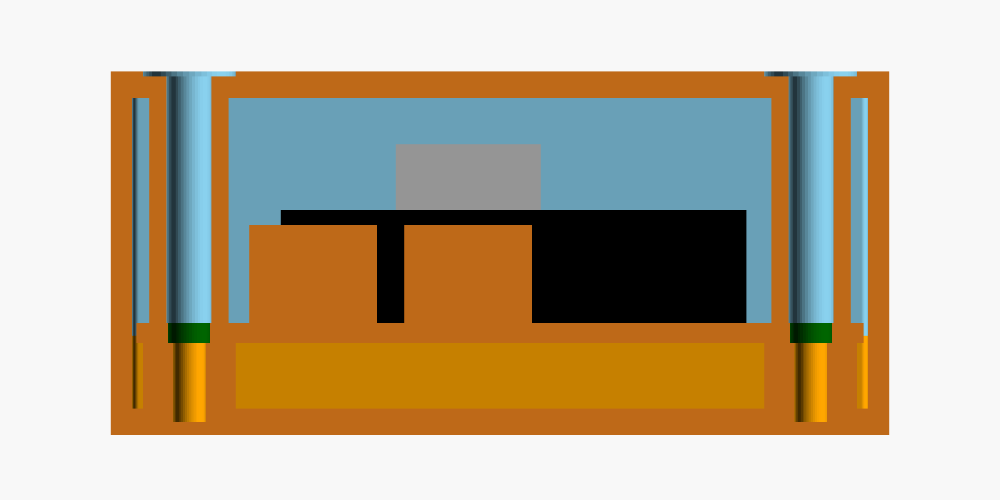

# A 3D-printed enclosure for the canfuel board

**A proposal, 19/11/2026, at the owner's request** — not yet printed or
fitted. Two parts, a bottom and a lid, held together by four M3 screws
through the board's own mounting holes. Printed on a Prusa at the owner's
work. Everything is generated from `enclosure.scad`; the STL files here are
its output and are what goes into PrusaSlicer.


*The lid lifted. Orange the bottom, blue the lid; the green board with
stand-ins for U1, Y1 and J1/J2, and white blocks where the plugs go.*

## Why there is an enclosure after all

`docs/implementation-plan.md` §9.1 dropped the enclosure (refuted entry D2
in `canfuel/docs/firmware/refuted.md`): nothing in the vent to short
against, no air, dust or water, and retention bought better by standoffs.
**All of that still holds.** What changed is the converter dropping out in
the car (`canfuel/docs/firmware/open.md` 12): cold joints on the first
board, an intermittent contact that a touch on the display brings back,
and a loom that is pulled and bent behind the MFD. The box buys two
things the standoffs do not:

- **the loom's pull ends at the box, not at J1/J2's solder joints** — a
  cable tie through the ledge in front of the connectors;
- **nothing presses on, bends or knocks the board** while the dashboard
  is worked on, and the board is clamped flat at its four holes, never
  by its edges.

Reopened by the owner, 19/11/2026.

## Dimensions

| | mm | from |
| --- | --- | --- |
| board | 55 × 45 × 1.5, holes 4 mm in on 47 × 37 | `canfuel.kicad_pcb` |
| inside, over the board | 17 | the owner: about 15 measured, 2 to spare |
| inside, under the board | 5 | the owner: leads at most 3 |
| board edge to wall | 0.3 each side | decision, below |
| wall / floor / roof | 1.6 / 2.0 / 2.0 | decision, below |
| **outside** | **58.8 × 48.8 × 27.5**, plus the screw heads (about 2–3) | derived |
| ledge in front of the connectors | 12 long, 7 tall | decision, below |

**Made as narrow as it goes, 19/11** (*owner*: the width across J1/J2's
edge, 50 mm in the first version, is what the vent limits; length and
height are fine; the wiring around it is factory loom). The board's 45 mm
plus 0.3 mm each side and a 1.6 mm wall; the tongue at the seam went to
make the wall thinner, and the ledge was halved. `wall = 1.2` (three
perimeters) takes 0.8 mm more if needed, at some stiffness. The owner may
fit it on a slant, the connector end low in front of the MFD and the far
end up behind; nothing in the box minds which way up it sits.

⚠ **The space in the vent was never measured** — the MFD15 is in the
way (§9.1); the estimate was about 65 × 55 mm, and the Hammond box that
was 60 × 55 × 30.1 came out at it on two axes. The owner prints it and tries it in place
(19/11); the bottom alone (about an hour) is the quick test.

## How it holds — the parts of the design



*A section through H1 and H2, seen from the connector side: the screw
through the lid's post and the board into the bottom's post.*

- **The board is clamped between two posts at each hole**: the bottom's
  post (⌀ 8) under it, the lid's post (⌀ 6) over it, and one **M3 × 25**
  screw down through the lid, the lid's post, the board's hole and into
  the bottom post. The screw also locates the board (M3 in a 3.2 mm hole).
  This is the "tubes from both sides" idea, with the screw doing the
  centring; a pin into the hole would have to share it with the screw.
- **The lid's posts stand 0.2 mm proud of the seam**, so the screws
  tighten onto the board, not onto the seam: the board cannot rattle,
  and the seam may show a hair of a gap. That is intended.
- **The posts have room around them**: over the board the nearest parts
  are R6's courtyard 3.84 mm from H2's centre and J1's 3.82 mm from H3's,
  so the lid's posts are ⌀ 6 (radius 3); under the board there is
  nothing but leads, so ⌀ 7, which leaves 0.8 mm to the wall.
- **The seam is a plain butt joint**: the four screws line the lid up.
  `tongue = true` puts back a 2 mm tongue of the bottom inside the lid's
  lower edge (1.0 mm thick, 0.2 mm clearance each side) — it needs
  `wall = 2.4`, 1.6 mm more width.
- **One slot for both connectors**, in the lid, **open at its lower
  edge**: the lid goes on over plugs already in place. 1 mm wider than the
  two headers each side and 12 mm tall over the board. The Molex
  43025-0400 receptacle's drawing is not in the repository, so the slot
  is the header (SD-43045-001: 9.65 wide, 7.37 tall) with room for the
  receptacle's latch above it — a decision, not a measurement.
- **The ledge**: under the plugs, 12 mm out from the wall, its top
  1.5 mm under the board's top surface, with a tunnel across it 7 mm out
  for a cable tie up to 3.6 mm wide. The receptacle's length is not on
  disk, so the tie goes round the plugs' bodies or just behind them —
  either way a pull on the loom reaches the box, not J1/J2's joints. As
  short as a tie allows (*the owner*, 19/11); `strain = false` leaves it
  off, and it can be sawn off a printed box.
- **No ventilation slots** (*the owner*, 20/11: dust gets in, and there is
  no heat to move). `vents = true` puts back six 1.8 mm slots in the roof. **Not needed for heat**:
  the board draws about 30 mA at 5 V (§9.2), about 0.15 W. Through the
  closed box's outside, about 0.012 m², at the 5–10 W/m²K of still air
  (*general*), that is 1.5–2.5 K above the air around it (*reasoned*;
  "well under a kelvin" until 20/11, a figure never worked out) — small
  against a 50–60 °C dashboard, and slots in still air behind a closed
  flap move little of it. They let the box
  breathe, and dust behind the vent's flap is not a concern (§9.1).
  `vents = false` closes them.
- **The name, `canfuel`, engraved 0.6 mm** (three layers) on the roof
  9 mm tall, and 4.5 mm tall on the ledge's front face
  (*the owner*, 19/11). One colour: it shows by its shadow. The roof's
  is printed in the lid's first layers, on the sheet, where a letter
  under about 5 mm would close up. 9 mm in the middle of the roof; with
  the slots on, 7 mm behind them. `label = ""` leaves both off.
- **A ⌀ 3.5 hole over each LED**, D1 and D2 (*the owner*, 19/11), so
  JP1's debug state shows without opening the box. `leds = false` closes
  them.

## Fixing: the screw cuts its own thread

**`fixing = "tap"`, the owner's choice (19/11)**: a 2.5 mm hole in each
bottom post, blind, 1 mm of floor left under it, and the screw cuts its
own thread in the plastic — an M3 × 25 machine screw or a 3.0 × 25 screw
for plastics. The thread holds about 4 mm. Good for a few dozen
openings; drive it in gently the first time, and if it is too stiff
open the hole with a 2.6 mm drill. 2.5 mm is a decision, between the
two kinds of screw, not a figure from a sheet.

**`fixing = "insert"`** is kept for later: an M3 × 5.7 brass heat-set
insert (OD 4.6, a 4.0 mm hole — check the insert's own sheet) pressed in
with the soldering iron, and an M3 screw in and out as often as needed;
`post_bot_d = 8` with it.

## Material and printing

- **PETG, not PLA.** A dashboard reaches 50–60 °C in summer (§9.1), and PLA
  softens around there; PETG holds well above it. ASA holds higher still
  but wants a printer with an enclosure (the Core One, not an open MK4).
  **Prusament PETG: HDT 68 °C** at 0.45 and at 1.80 MPa, ISO 75
  (Prusament PETG technical data sheet v1.1, 2/2022, read from a
  reseller's copy; no glass transition given). That is above the
  dashboard's 50–60 °C but not by much in a car parked in the sun, and a
  printed part under a screw's clamp creeps first: **watch the first
  summer**, and if the box or its posts sag, reprint in ASA. A "Generic
  PETG" spool has no sheet here; its figure is not known.
- **Orientation**: the bottom on its floor; the lid **roof down** (the
  `lid.stl` is already turned that way). **No supports** either way: the
  slot is open at the top as printed, and the tie tunnel is a 4.5 mm
  bridge.
- PrusaSlicer: the printer's own *0.20 mm QUALITY* profile and the
  filament's own profile; **4 perimeters**, 20–25 % infill. Nothing else
  changed.
- Time: roughly 1 h the bottom, 1½ h the lid (PrusaSlicer says exactly).

## Parts

| | qty |
| --- | --- |
| M3 × 25 screw, socket head (ISO 4762) or pan head (ISO 7380 / DIN 7985), or a 3.0 × 25 screw for plastics; steel or A2 | 4 |
| cable tie, up to 3.6 mm wide | 1 |
| 3M VHB or equal automotive double-sided tape, for the box's floor | a strip |

The board's four nylon standoffs (§9.1) are not needed inside the box: its
own posts replace them. The VHB moves from the standoffs' feet to the box's
floor and the ledge's underside.

## Assembly

1. Board into the bottom, components up, connectors to the slot side.
2. Lid on; the slot comes down over J1/J2.
3. Four screws, snug — the board is clamped, do not crush it.
4. Plug in, a tie through the ledge's tunnel round the loom behind the
   plug, tight.
5. VHB on the floor and the ledge, into the vent.

## What was printed

`prusa_canfuel_0.4n_0.2mm_PETG_MK4S_1h25m.bgcode` is the file the owner
sliced and printed on 20/11/2026, both parts on one sheet: by its own
header an MK4S with the 0.4 high-flow nozzle, PETG, 0.2 mm layers, 20 %
infill, 25.6 g and 1 h 25 min. Kept, as `fab/` is, so what was printed
can be found again; it is output, sliced from the STLs here, and is
re-sliced whenever they change.

⚠ **Its lid is mirrored** (*the owner*, 20/11: the name reads backwards
and the connector slot is at the wrong end). `enclosure.scad` turned the
lid roof-down with `mirror([0, 0, 1])`, which turns it inside out as well
as over; it now does it with `rotate([180, 0, 0])`, and `lid.stl` was
regenerated and checked by turning it back over. The bottom was never
transformed and is right. The `.bgcode` stays as the record of the first
print; it is not to be printed again.

## Changing it

`enclosure.scad` is parametric — every number above is a named variable at
its top. OpenSCAD (free) opens it; `F5` previews, `F6` renders. To
regenerate the files:

```sh
openscad -D 'part="bottom"' -o bottom.stl enclosure.scad
openscad -D 'part="lid"'    -o lid.stl    enclosure.scad
openscad -D 'part="assembly"' --imgsize=1200,900 --camera=27,22,14,55,0,330,190 --colorscheme=Tomorrow -o assembly.png enclosure.scad
openscad -D 'part="section"'  --imgsize=1400,700 --camera=27.5,4,14,90,0,0,95 --projection=o --colorscheme=Tomorrow -o section.png enclosure.scad
```

The STLs here were made by OpenSCAD 2021.01 and both report a single
closed solid.

## Not known until it is printed

- **Whether it fits the vent** (above).
- **The receptacle's outline** in the slot: the slot is generous; if the
  latch fouls, `slot_h` up.
- **Whether the ledge is in the way** in the vent; `strain = false` or a
  saw.
