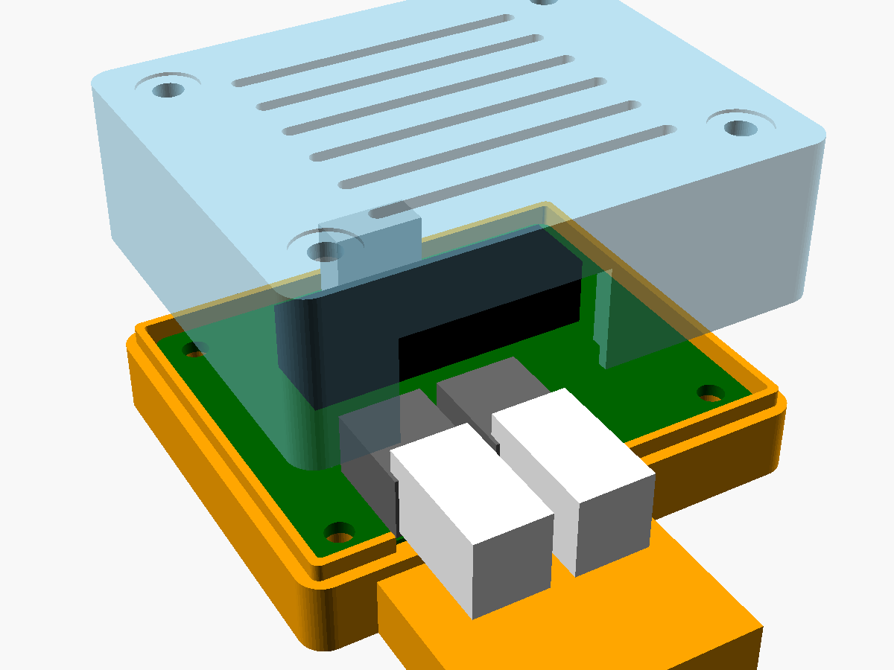

# A 3D-printed enclosure for the canfuel board

**A proposal, 19/11/2026, at the owner's request** — not yet printed or
fitted. Two parts, a bottom and a lid, held together by four M3 screws
through the board's own mounting holes. Printed on a Prusa at the owner's
work. Everything is generated from `enclosure.scad`; the STL files here are
its output and are what goes into PrusaSlicer.



*The lid lifted. Orange the bottom, blue the lid; the green board with
stand-ins for U1, Y1 and J1/J2, and white blocks where the plugs go.*

## Why there is an enclosure after all

`docs/implementation-plan.md` §9.1 dropped the enclosure (refuted entry D2
in `canfuel/docs/firmware/refuted.md`): nothing in the vent to short
against, no air, dust or water, and retention bought better by standoffs.
**All of that still holds.** What changed is the converter dropping out in
the car (`canfuel/docs/firmware/open.md` 12): cold joints on the first
board, an intermittent contact that a touch on the display brings back,
and a loom that is pulled and bent behind the MFD. The box buys two
things the standoffs do not:

- **the loom's pull ends at the box, not at J1/J2's solder joints** — a
  cable tie through the ledge in front of the connectors;
- **nothing presses on, bends or knocks the board** while the dashboard
  is worked on, and the board is clamped flat at its four holes, never
  by its edges.

Reopened by the owner, 19/11/2026.

## Dimensions

| | mm | from |
| --- | --- | --- |
| board | 55 × 45 × 1.5, holes 4 mm in on 47 × 37 | `canfuel.kicad_pcb` |
| inside, over the board | 17 | the owner: about 15 measured, 2 to spare |
| inside, under the board | 5 | the owner: leads at most 3 |
| board edge to wall | 0.5 each side | decision, below |
| wall / floor / roof | 2.4 / 2.0 / 2.0 | decision, below |
| **outside** | **60.8 × 50.8 × 27.5**, plus the screw heads (about 2–3) | derived |
| ledge in front of the connectors | 24 long, 7 tall | decision, below |

⚠ **The space in the vent was never measured** — the MFD15 is in the
way (§9.1); the estimate was about 65 × 55 mm, and the Hammond box that
was 60 × 55 × 30.1 came out at it on two axes. **Check the space before
printing**: a cardboard box of 61 × 51 × 30 mm is enough, or print the
bottom alone first (about an hour) and try it in the vent. If it is too
big, `wall = 2.0` and `gap = 0.3` take 1.2 mm off each side; `above` can
come down to 15 + something if the tallest part allows.

## How it holds — the parts of the design


*A section through H1 and H2, seen from the connector side: the screw
through the lid's post and the board into the bottom's post; the tongue
of the bottom inside the lid's lower edge, left and right.*

- **The board is clamped between two posts at each hole**: the bottom's
  post (⌀ 8) under it, the lid's post (⌀ 6) over it, and one **M3 × 25**
  screw down through the lid, the lid's post, the board's hole and into
  the bottom post. The screw also locates the board (M3 in a 3.2 mm hole).
  This is the "tubes from both sides" idea, with the screw doing the
  centring; a pin into the hole would have to share it with the screw.
- **The lid's posts stand 0.2 mm proud of the seam**, so the screws
  tighten onto the board, not onto the seam: the board cannot rattle,
  and the seam may show a hair of a gap. That is intended.
- **The posts have room around them**: over the board the nearest parts
  are R6's courtyard 3.84 mm from H2's centre and J1's 3.82 mm from H3's,
  so the lid's posts are ⌀ 6 (radius 3); under the board there is
  nothing but leads, so ⌀ 8 for the insert.
- **The bottom has a tongue that goes 2 mm up inside the lid's lower
  edge** (1.0 mm thick, 0.2 mm clearance each side). It lines the lid up
  and closes the seam.
- **One slot for both connectors**, in the lid, **open at its lower
  edge**: the lid goes on over plugs already in place. 1 mm wider than the
  two headers each side and 12 mm tall over the board. The Molex
  43025-0400 receptacle's drawing is not in the repository, so the slot
  is the header (SD-43045-001: 9.65 wide, 7.37 tall) with room for the
  receptacle's latch above it — a decision, not a measurement.
- **The ledge**: under the plugs, its top 1.5 mm under the board's top
  surface, with a tunnel across it 17 mm out from the wall for a cable
  tie up to 3.6 mm wide. The tie goes round the loom just behind the
  plugs, so a pull on the loom reaches the box. `strain = false` leaves it
  off.
- **Six ventilation slots** in the roof (1.8 mm). **Not needed for heat**:
  the board draws about 30 mA at 5 V (§9.2), about 0.15 W, which warms a
  box this size by well under a kelvin (*reasoned*). They let the box
  breathe, and dust behind the vent's flap is not a concern (§9.1).
  `vents = false` closes them.
- **The LEDs are covered**, as the owner asked: for debugging the board
  comes out. `leds = true` puts a ⌀ 3.2 hole over D1 and D2.

## Fixing: heat-set inserts, or the screw straight into plastic

**Default, `fixing = "insert"`: M3 brass heat-set inserts** (M3 × 5.7,
OD 4.6, for a 4.0 mm hole — e.g. Ruthex RX-M3x5.7 or CNC Kitchen's M3
standard; check the insert's own sheet for its hole size and change
`insert_d` if it differs). Pressed into the bottom's posts with a
soldering iron at about the filament's printing temperature, straight
down, until flush. A screw can then go in and out as often as needed —
the board will come out for debugging.

**`fixing = "tap"`**: a 2.6 mm hole and the M3 screw cuts its own thread.
No inserts, no iron; good for a few dozen openings before it loosens.

## Material and printing

- **PETG, not PLA.** A dashboard reaches 50–60 °C in summer (§9.1), and PLA
  softens around there; PETG holds well above it. ASA holds higher still
  but wants a printer with an enclosure (the Core One, not an open MK4).
  The heat-deflection figures were not checked against Prusament's own
  sheets — read them if it matters.
- **Orientation**: the bottom on its floor; the lid **roof down** (the
  `lid.stl` is already turned that way). **No supports** either way: the
  slot is open at the top as printed, and the tie tunnel is a 4.5 mm
  bridge.
- PrusaSlicer: the printer's own *0.20 mm QUALITY* profile and the
  filament's own profile; **4 perimeters**, 20–25 % infill. Nothing else
  changed.
- Time: roughly 1 h the bottom, 1½ h the lid (PrusaSlicer says exactly).

## Parts

| | qty |
| --- | --- |
| M3 × 25 screw, socket head (ISO 4762) or pan head (ISO 7380 / DIN 7985), steel or A2 | 4 |
| M3 heat-set insert, M3 × 5.7, OD 4.6 (only with `fixing = "insert"`) | 4 |
| cable tie, up to 3.6 mm wide | 1 |
| 3M VHB or equal automotive double-sided tape, for the box's floor | a strip |

The board's four nylon standoffs (§9.1) are not needed inside the box: its
own posts replace them. The VHB moves from the standoffs' feet to the box's
floor and the ledge's underside.

## Assembly

1. Inserts into the bottom's four posts (with the iron), flush; let cool.
2. Board into the bottom, components up, connectors to the slot side.
3. Lid on; the slot comes down over J1/J2.
4. Four M3 × 25 screws, snug — the board is clamped, do not crush it.
5. Plug in, a tie through the ledge's tunnel round the loom behind the
   plug, tight.
6. VHB on the floor and the ledge, into the vent.

## Changing it

`enclosure.scad` is parametric — every number above is a named variable at
its top. OpenSCAD (free) opens it; `F5` previews, `F6` renders. To
regenerate the files:

```sh
openscad -D 'part="bottom"' -o bottom.stl enclosure.scad
openscad -D 'part="lid"'    -o lid.stl    enclosure.scad
openscad -D 'part="assembly"' --imgsize=1200,900 --camera=27,22,14,55,0,330,190 --colorscheme=Tomorrow -o assembly.png enclosure.scad
openscad -D 'part="section"'  --imgsize=1400,700 --camera=27.5,4,14,90,0,0,95 --projection=o --colorscheme=Tomorrow -o section.png enclosure.scad
```

The STLs here were made by OpenSCAD 2021.01 and both report a single
closed solid.

## Not known until it is printed

- **Whether it fits the vent** (above).
- **The receptacle's outline** in the slot: the slot is generous; if the
  latch fouls, `slot_h` up.
- **The fit of tongue and lid** on this printer: 0.2 mm per side is the
  usual starting point for a Prusa; tight → `fit = 0.3`, loose → 0.15.
